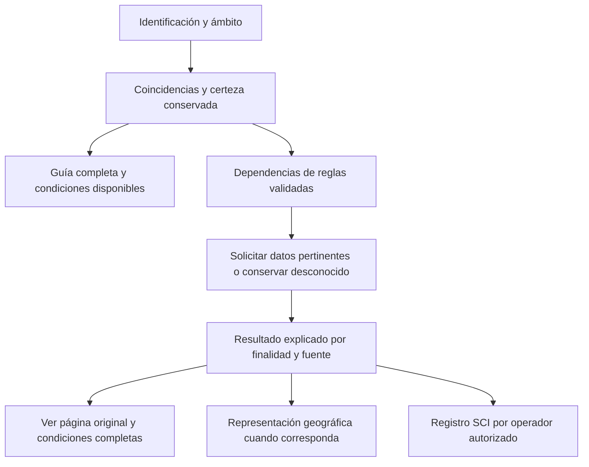

# Análisis de mejora de la integración GRE en SIGBO

Actualización posterior a este análisis: el usuario autorizó aplicar las mejoras.
La [implementación local](IMPLEMENTACION_MEJORA_20261011.md) registra código, fuentes,
comprobaciones y pendientes; las observaciones que siguen conservan el estado previo.

Fecha: 2026-10-11. Estado: propuesta técnica, sin implementación ni aceptación
institucional. Complementa la [arquitectura de fase 2](FASE_2_ARQUITECTURA.md) y la
[entrega local](FASE_4_5_CONSULTA_MOTOR.md). No modifica contratos, SQL, autoridades
ni edición activa.

## Recomendación

Evolucionar hacia una consulta guiada por reglas explícitas, versionadas y explicables.
Conservar el catálogo documental y el evaluador determinista existentes. Estructurar
las condiciones antes de usarlas y registrar qué capacidades están validadas. La
pantalla debe pedir datos pertinentes al caso y presentar conjuntamente resultado,
condiciones, incertidumbre y fuente.

Las 392 páginas con revisión registrada permiten localizar contenido. No demuestran
interpretación exhaustiva de sus condiciones. Representar también lo que requiere
lectura o juicio especializado, conservando el texto íntegro. Clasificar todas las
cláusulas pertinentes no significa automatizar todas las acciones.

La GRE orienta la respuesta inicial a incidentes de transporte, según
[PHMSA](https://www.phmsa.dot.gov/training/hazmat/erg/emergency-response-guidebook-erg).
[Transport Canada](https://tc.canada.ca/en/dangerous-goods/canutec/emergency-response-guidebook)
explica que su utilidad puede ser menor en instalaciones fijas, aeronaves o buques.
Propongo registrar el ámbito de uso y presentar su limitación cuando corresponda.

## Base que debe conservarse

- Fuente original, huellas, versiones inmutables y activación humana separada.
- Identidad de entrada distinta del número ONU y selección explícita entre nombres.
- Motor sin escritura, reloj ni dependencia de meteorología o IA externas.
- Decimales exactos, desconocido distinto de cero/falso y calidad de los parámetros.
- Referencias por campo, guías completas y páginas PDF e impresa diferenciadas.
- Separación entre consulta, geometría complementaria y decisión de mando.
- Descarga documental web/Flutter y conservación de ediciones anteriores.

Estas piezas existen en código. No se comprobó en esta revisión su disponibilidad
institucional ni la aplicación de migraciones.

## Hallazgos y mejoras concretas

| Observación actual | Mejora propuesta | Beneficio |
|---|---|---|
| La rama no verde devuelve NO_APLICABLE para tablas y para aislamiento/protección generales | Separar aplicabilidad de cada fuente y estado del resultado general; señalar consulta/evaluación de distancias naranjas | Evitar que excluir Tabla 1 se interprete como ausencia de distancias pertinentes |
| Las cantidades nominales de recipientes de Tabla 3 se recuperan por expresión regular del texto durante la evaluación | Extraerlas, tiparlas y cotejarlas al preparar un candidato nuevo | Evitar interpretación de formato editorial en cada consulta |
| Rxx, reglas GRE24 documentadas y cláusulas de guías tienen alcances distintos | Registro de correspondencias, conservando ids originales, fuentes, interpretación y validación | Demostrar cobertura sin confundir 54 reglas documentadas con todas las reglas |
| La respuesta incluye motivos/referencias, pero no una secuencia completa de condiciones evaluadas | Traza por resultado: condiciones conocidas/desconocidas, reglas aplicadas y filas elegidas/descartadas | Explicar y revisar cada selección |
| Se ofrecen cantidad, agua, periodo y velocidad antes de conocer las necesidades de cada resultado | Captura progresiva según dependencias del evaluador, con acceso directo a guía/PDF | Reducir carga sin ocultar información disponible |
| La evaluación identifica materiales por ids; no incluye certeza/método de identificación | Añadir observación original, método y certeza al contrato nuevo | Una coincidencia documental no confirma la sustancia observada |
| Flutter carga JSON completo y PDF base64; el HTML completo medido anteriormente ocupa 39.130.727bytes | Evaluar manifiesto, catálogo y PDF separados, índices locales y lectura fuera del hilo de interfaz | Reducir copias en memoria; medir el beneficio en teléfono real |

La primera observación se localiza en
[motor-matpel.service.ts](../../backend/src/modules/gre/motor-matpel.service.ts:67)
y los títulos generales de la
[pantalla](../../frontend/src/app/dashboard/matpel/page.tsx:201).
Se reprodujo con el motor compilado y el recorte documental real, usando el mismo
plan de carga de las pruebas existentes: la entrada 1613 no verde conserva guía154
pero devuelve NO_APLICABLE para Tabla 1, aislamiento y protección. No se inventó una
distancia ni se consultó SQL. Esta ejecución no es validación operacional.

R13/R15 excluyen Tabla 1; PDF 349 / impresa 347 remite a las distancias de la guía naranja.
Por tanto, el estado general necesita alcance explícito. La guía ya está disponible;
el hallazgo afecta la interpretación del resultado, no la ausencia de todo su contenido.
La reinterpretación de recipientes por texto está en el mismo motor desde la línea182.

## Reglas estructuradas y resultados

Mantener una sola definición versionada de las reglas ejecutables. Relacionar por
regla: id, ámbito/material, condiciones necesarias, excepciones, resultado/finalidad,
fuente literal, páginas, interpretación, versión, revisión independiente y casos de
aceptación. Clasificar tratamiento: selección automática, advertencia contextual o
lectura/decisión humana.

Para este alcance bastan funciones tipadas y tablas de decisión con operadores
limitados: igualdad, pertenencia, comparación decimal y combinación de condiciones.
Validar esquema y dependencias antes de publicar una interpretación. No ejecutar
Markdown ni expresiones JavaScript guardadas en SQL. Ante una condición desconocida,
conservar indeterminación o aplicar sólo la alternativa explícitamente autorizada por
la fuente.

Separar cotejo del catálogo, validación de una interpretación y aceptación para uso.
`ejecutable=true` no acredita esas tres cosas. Conservar controles actuales de
revisión/activación y añadir controles del alcance ejecutable, sin rebajar requisitos.

Proponer un contrato nuevo de resultado con:

- Finalidad: aislamiento, acción protectora o evacuación según la fuente.
- Fuente y escenario: guía naranja, tabla verde u otra sección.
- Aplicabilidad y estado de implementación/validación, separados.
- Valor original, unidad, modificador, condiciones y alternativas pertinentes.
- Incógnitas, calidad de identificación/datos y siguiente dato necesario.
- Reglas realmente aplicadas, referencias y traza de selección.

Identificar evaluación por versiónGRE, hash del catálogo, versión/hash de interpretación,
versión de motor y entradas. El inputsHash actual incluye documento, versiónGRE y
motor; explicitar además huellas del contenido estructurado y de interpretación
facilitaría reproducción histórica. Evolucionar el contrato conservando consumidores
actuales; no cambiar silenciosamente significado o forma de campos existentes.

## Recorrido del operador

El último nodo es integración institucional futura. Consultar no crea incidente ni
registra decisión. Guía, identificación y datos disponibles permanecen accesibles sin
una cadena de diálogos obligatorios. Ubicación/dirección del viento son requisitos de
geometría; no bloquean distancias textuales disponibles. Reutilizar datos anteriores
mostrando origen, instante y certeza, sin confirmarlos ni presumir su vigencia.

## Evidencia GRE que limita el diseño

| Regla/evidencia | Fuente original | Consecuencia |
|---|---|---|
| R02, flujo de un material | PDF 3; impresa 1 | Varios materiales requieren otro recorrido; no combinar números en un perímetro de mezcla |
| R13/R15 y R14 | PDF 296/349; impresas 294/347 | Separar tablas y guías, y las finalidades de distancias con/sin incendio |
| R16/R17 | PDF 294–296; impresas 292–294 | Conservar volumen liberado y definición día/noche; no deducir volumen desde masa ni usar horarios universales |
| R18/R19 | PDF 296/287; impresas 294/285 | Selección mayor para protección bajo sus condiciones; no extenderla a aislamiento |
| R23/R24 y GRE24-T3-CONTENEDORES-CANTIDADES | PDF 340; impresa 338 | Capacidad nominal, cantidad liberada, número de recipientes y velocidad son datos distintos |
| R25/R26/R27 | PDF 297/287; impresas 295/285 | La geometría representa la figura GRE; no garantiza dispersión ni borde máximo para valores con + |
| R28/R30 y GRE24-ISSUE-INSTANT-RELEASE | PDF 286–287/297; impresas 284–285/295 | Conservar formulaciones y resolver alcance antes de automatizar ajustes |

Se consultaron esas páginas del [PDF original](../Manuales/GRE2024-Spa-Web-a.pdf),
392 páginas, SHA-256:
`bfc8b663259528dadd81a499afac2d5fd417467786ac616fb31625680f4ea4af`.
Es cotejo focalizado por lectura nativa; no nueva revisión independiente integral ni
prueba operacional. Las condiciones particulares de cada guía requieren su propia
formalización y revisión antes de ejecutarse.

## Web, móvil y SCI

Conservar NestJS, SQL Server, Next y Flutter. Extraer gradualmente funciones puras
dentro del monolito, manteniendo servicio/API actual como adaptador. Comparar
comportamiento antes/después con los casos existentes.

Para desconexión, priorizar biblioteca documental eficiente y dispositivo físico.
Un motor móvil posterior consumirá las mismas definiciones versionadas. TypeScript
y Dart requieren implementaciones compatibles: compartir JSON no garantiza resultados
iguales. Exigir una batería común de casos cotejados, comparación de resultados,
decimales exactos y rechazo de perfiles no admitidos antes de habilitar evaluación
desconectada. Conservar mientras tanto la lectura offline actual con alcance explícito.

Catálogo documental e incidentes tienen ciclos distintos. Publicar una descarga
verificada mediante cambio atómico del puntero, conservando la copia válida si falla
la actualización. Medir tiempo, memoria y recuperación antes de incorporar otro
almacenamiento local. Para distribución fuera del canal autenticado, evaluar manifiesto
firmado: hashes dentro del propio paquete comprueban consistencia, pero por sí solos
no acreditan quién lo publicó.

SCI consumirá el mismo evaluador sobre el mismo Servicio y cronología. Conservar
snapshots de datos, resultado y fuente, revisión esperada, idempotencia y auditoría
transaccional. Guardar evaluación no equivale a adoptar una decisión; recalcular no
reescribe decisiones anteriores. Las mutaciones institucionales siguen pendientes:
AGENTS exige consultar artículos del Reglamento original para modificar Servicios/mando,
y el usuario indicó no tenerlo. El análisis y la consulta documental pueden avanzar
independientemente.

## Alternativas

| Alternativa | Evaluación |
|---|---|
| Ampliar selector de tablas y formulario general | Útil para consultas limitadas; dificulta demostrar alcance y pedir sólo datos pertinentes |
| Reglas tipadas, tablas de decisión acotadas y consulta guiada | Recomendada: reutiliza la base y permite explicar/validar cada ampliación |
| Motor genérico configurable libremente | Añade precedencias, ciclos y cambios de interpretación difíciles de revisar; no justificado ahora |
| Chat/RAG como evaluador principal | Recuperar texto no acredita condiciones; puede después localizar/explicar fuentes consumiendo el evaluador validado |
| Simulador de dispersión como sustituto | Cambia alcance y requiere otros datos/modelos/validaciones; la figura GRE no acredita esa capacidad |

## Orden de ejecución y criterios de cierre

1. **Precisar resultados.** Corregir presentación de entradas no verdes y separar
   finalidad, fuente y capacidad. Guía/PDF accesibles aunque tablas no apliquen.
2. **Estructurar Tabla 3.** Candidato nuevo con cantidades nominales cotejadas;
   preservar candidato congelado y ediciones anteriores. Comparar límites, unidades,
   selección e indeterminaciones con casos actuales.
3. **Registrar cobertura y ampliar guías naranjas.** Clasificar cada cláusula como
   lectura, advertencia o cálculo. Ampliar sólo condiciones revisadas; cotejo independiente
   de original, verde, encabezados y finalidad.
4. **Guiar captura.** Comprobar con operadores identificación, peligros, acceso a
   fuente y resolución de incógnitas sin datos inventados ni bloqueos.
5. **Comprobar móvil.** Fuente completa en teléfono real: tiempos/memoria, desconexión,
   corrupción, recuperación y actualización. Motor offline tras conformidad entre plataformas.
6. **Integrar SCI/OCR.** Tras resolver fuente institucional, permisos y evidencias,
   comprobar concurrencia, historial y autoridad. OCR propone candidatos; conservar
   observación original y acceso manual.

Pruebas de abstención, condiciones negativas, cambio de unidades, límites, calidad
no confirmada y conservación de fuentes. Esperados críticos cotejados con el PDF,
no derivados exclusivamente del parser/motor evaluado. Publicar alcance y pendientes
por capacidad; los conteos de pruebas no sustituyen aceptación institucional.

## Comprobaciones y límites de esta revisión

Contexto general/local, grafo L2, arquitectura anterior, código de motor/consulta,
paquete, Flutter y cronología; cotejo focalizado de PDF y fuentes oficiales.
Transport Canada no listaba correcciones 2024 al consultar su
[página de correcciones](https://tc.canada.ca/en/dangerous-goods/canutec/emergency-response-guidebook/corrections)
en esta revisión. No acredita ausencia universal de erratas ni vigencia de contactos.

La primera ejecución aislada falló al tratar el contenedor del recorte como catálogo;
se corrigió usando artefactoRecortado y planDeCarga, como las pruebas existentes.
La segunda confirmó los estados descritos para la entrada 1613. No se modificó la
fuente ni se importaron registros. No se repitieron suites/builds anteriores ni se
implementaron estas mejoras. Sus resultados históricos conservan fecha y límites.
